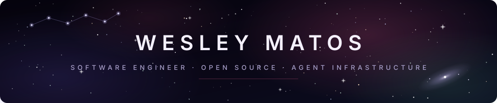

  

Software engineer from São Paulo, Brazil. Curious from birth, learning how the world works from the inside and from the outside — and expressing it with technology: agent infrastructure, open source, and streaming systems for hundreds of millions of people.

## ✦ Now

- Contributing to [OrchestratorInc/agent-orchestrator](https://github.com/OrchestratorInc/agent-orchestrator): native [ZCode chat integration](https://github.com/OrchestratorInc/agent-orchestrator/pull/6003) and [Hermes Agent harness with ACP chat](https://github.com/OrchestratorInc/agent-orchestrator/pull/6635), both in review
- Building on [Hermes Agent](https://github.com/wesleymatosdev/hermes-agent): skills, plugins, loop and harness engineering
- Rebuilding my home on GitHub — [The Star Map](https://wesleymatosdev.github.io/) (every project delivered, mapped onto the real night sky) plus a new blog at `wesleymatosdev.github.io/blog`

## ✦ Open source

**54 merged PRs across 16 repositories.** A selection:

| Project | What I contributed |
| --- | --- |
| [rust-lang/rustfmt](https://github.com/rust-lang/rustfmt) | semver support for `required_version` per the Rust Book spec (#6066, #7048) |
| [mediar-ai/screenpipe](https://github.com/mediar-ai/screenpipe) | early contributor — 22 merged PRs: CI/CD pipelines, Deno & Bun SDK test automation, multi-monitor support with real monitor names, H.265 capture on macOS, Sentry error tracking, automated release notes |
| [calcom/cal.diy](https://github.com/calcom/cal.diy) | QA and test automation for payments, calendar and webhooks |
| [triggerdotdev/trigger.dev](https://github.com/triggerdotdev/trigger.dev) | ESLint plugin enforcing task-key uniqueness; CLI test suite |
| [nashaofu/xcap](https://github.com/nashaofu/xcap) | real-time tracking of open apps and connected monitors, via Apple APIs |
| [qdrant/qdrant](https://github.com/qdrant/qdrant) | read-only API keys |
| [zio/zio-json](https://github.com/zio/zio-json) | 256-bit integer decoding |
| [permitio/docs](https://github.com/permitio/docs) | Docusaurus v3.7 docs upgrade |

Plus one-off merged fixes in Handy, ts-jest, firstmate, Cap-go, inb, zcode-cli, ai-memory and marinara.

## ✦ Experience

- **Warner Bros. Discovery** (via Globant) · Senior Software Engineer → Staff Cloud/SRE Engineer — streaming infrastructure behind `hbomax.com`, `cnn.com` and `discoveryplus.com`: hundreds of millions of users (95M on HBO alone), multi-region multi-cloud CDNs toward a 99.99999% availability target, GraphQL at 15–25M requests/day, Kafka/SQS content pipelines, a legacy-CMS replacement saving $5M/yr, and 100+ CVEs remediated across 50+ repositories
- **Influencer** · Staff Software Engineer — creator-discovery platform fusing AI inference with creator, audience and demographic filters; vector search over AI embeddings; cut third-party API latency from 30s to 900ms (97%)
- **Luxury Presence** · Senior Software Engineer II — Testcontainers running parallel E2E suites against live PostgreSQL, SQS and Redis; 100+ test cases; an SDK replacing 10k+ lines of duplicated logic across six NestJS microservices
- Before that: fintech and e-commerce engineering in São Paulo (Provi, FCamara/Dasa, Marketdata/Cielo, RedFox) and teaching 200+ students HTML, CSS, JS, React and Node with Meta's Hack Station

## ✦ Some things I've built

- [awesome-acp](https://github.com/wesleymatosdev/awesome-acp) — curated resources for the Agent Client Protocol
- [hermes-orchestrator](https://github.com/wesleymatosdev/hermes-orchestrator) — merge-friendly agent-orchestrator fork with first-class Hermes support
- [hermes-classifier-mode](https://github.com/wesleymatosdev/hermes-classifier-mode) — Claude Code's auto permission mode reviewed by a local LLM (Ollama, on-device)
- [ai-usage-optimizer](https://github.com/wesleymatosdev/ai-usage-optimizer) — routes AI provider and model usage by measured headroom
- [lolcompanion](https://github.com/wesleymatosdev/lolcompanion) — lightweight League of Legends companion, Wails v3 + Go over LCU and Live Client APIs, no injection
- [awesome-brazil](https://github.com/wesleymatosdev/awesome-brazil) — civic tech and open data in Brazil 🇧🇷
- [bela-portfolio](https://github.com/wesleymatosdev/bela-portfolio) — a client's portfolio

## ✦ Stack

**Languages** JavaScript · TypeScript · Rust · Go · Python · Node.js · Deno · Bun
**Web** React · Next.js · Vue · NestJS · GraphQL · Fastify
**Infra & data** AWS · GCP · Kubernetes · Terraform · Kafka · PostgreSQL · Redis · Elasticsearch · Fastly · Akamai
**Agent stack** Ollama · MCP · Qdrant · embeddings & vector search · agent skills and plugins · spec-driven development · harness/loop engineering

## ✦ Find me

✉️ wesleymatosdev@gmail.com · 💼 [linkedin.com/in/wesleymatosdev](https://www.linkedin.com/in/wesleymatosdev) · 🌌 [The Star Map](https://wesleymatosdev.github.io/)